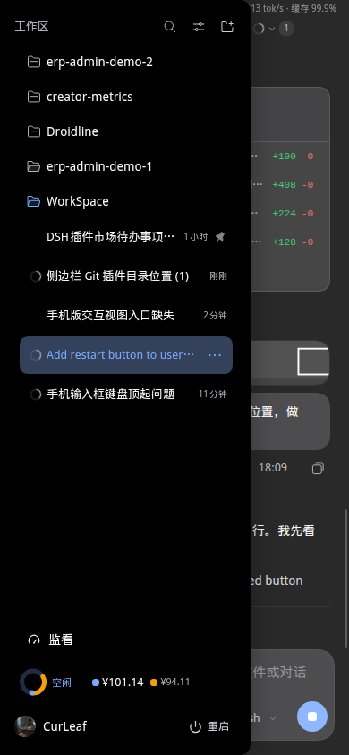
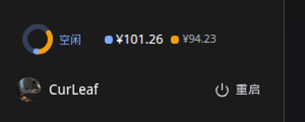

# dsh-restart-button

给 DSH 外壳加一个**重启按钮**：桌面侧栏和手机抽屉里都能点，位置在**最下面那一行账号（头像）的右端**，不额外占一行。

改插件、换配置以后总要重启 `dsh web` —— 在电脑上还能 `systemctl --user restart dsh-web`，在手机上则要回到终端。
这个插件把这件事收进界面：两段式确认（防误触），点完自动等进程回来并刷新页面。

```
[监看]
[工作区 Git]
[计费]
[avatar] CurLeaf ............ [⏻ 重启]   ← 本插件贴在账号行右侧
```

手机抽屉（真机 390×844）：



桌面侧栏与确认态：

| 侧栏（宽） | 两段式确认 |
|---|---|
|  |  |

## 安装

```bash
dsh plugin --profile web add link:~/WorkSpace/dsh-plugins/packages/dsh-restart-button
```

装完重启一次 `dsh web`（首次安装的 bundle 在启动时读入）。之后按钮常驻在账号行右端：
桌面侧栏和手机抽屉是同一个 `SidebarRoot`，一个锚点两边都长；侧栏折叠成 56px 导轨时隐藏。

## 行为

| 场景 | 发生什么 |
|---|---|
| 第一下点击 | 原地展开成「⏻ 确认重启？」（警示色），4 秒内不点第二下就自动收回 |
| 第二下点击 | `POST api/restart-button/restart`；顶部弹出「正在重启 DSH…」，按钮进入「重启中…」 |
| 服务回来 | 轮询发现 `pid` 变了 → 提示「已重启，正在刷新…」→ 自动刷新页面 |
| 45 秒没回来 | 提示「没等到 DSH 回来」，给一个「重试」，并在小字里让你去终端检查 |
| 请求没送达 | 提示「重启请求没有送达」，不假装成功 |

按钮本身只发一个受鉴权的请求；重启的三条路都在宿主侧：

| 运行方式 | 怎么重启 | 说明 |
|---|---|---|
| **systemd 用户服务**（默认） | 起一只 1 秒后触发的瞬态 timer，执行 `systemctl --user restart <unit>` | unit 名从 `/proc/self/cgroup` 读（例如 `dsh-web.service`），不写死；瞬态单元在本进程被停掉之后仍然完成重启 |
| **自定义命令** | `/bin/sh -c <command>` | profile 里配 `command` 时优先用它 |
| **前台 / 容器** | 退出进程，等外部 supervisor 拉起 | 没有 systemd 时的退路；`dsh` 是前台跑的就表现为「服务停了」 |

## 配置（可选）

```yaml
# ~/.dsh/profiles/web/cordis.patch.yml
- id: restart-button
  name: dsh-restart-button
  config:
    # 显式指定 systemd 单元；不写就从 cgroup 读
    service: dsh-web.service
    # 自定义重启命令（写了就优先于 systemd）
    command: null
    # 延迟几秒动手（0–30，默认 1）：给响应和前端留时间
    delaySeconds: 1
```

## 安全边界

- 两条路由都注册在 `connection` 服务的 `/api` 通道上：Host/Origin 校验、浏览器会话 Cookie 由宿主先做，**没登录的请求进不到处理函数**；
- 不接收任何路径、命令、参数：配置只从 profile 读，浏览器只能点「重启」；
- 单进程 5 秒冷却，连点不会刷出一串瞬态单元；
- 重启会中断正在运行的会话（工具调用会被打断）——所以有第二下确认，按钮的 `title` 也写明了这一点。

## 卸载

```bash
dsh plugin --profile web remove dsh-restart-button
```

再重启一次即可。

## 开发

```bash
node --test test/*.test.mjs
```

- `lib/plan.js` 是纯函数：cgroup 解析、延迟夹取、三条路的优先级，测试覆盖 `command / systemd / exit` 与两个边界；
- `lib/index.js` 的 `launchRestart` 把 `spawn` / `exit` 作为注入点，测试里走完三条路而不真的重启；
- `lib/client.js` 用 jsdom 搭出宿主账号行的最小结构，断言：按钮挂在行里、确认态与自动收回、折叠时隐藏、React 重建行后自动挂回、第二下发 POST、卸载清理干净。

## 已知边界

| 项 | 现状 |
|---|---|
| Windows / macOS 桌面版 | 没有 systemd，走 `exit` 退路；桌面壳是否自动拉起取决于它自己的 supervisor |
| 非 systemd 的 Linux | 同上；如果 `dsh` 是你在终端里前台跑的，点了之后需要手动再起 |
| 重启耗时 | systemd 路径约 2–5 秒；配置多、插件多的 profile 会更久，客户端最多等 45 秒 |
| 页面状态 | 重启后自动刷新，会话在服务端，不会丢；但正在生成的那一轮会被打断 |
